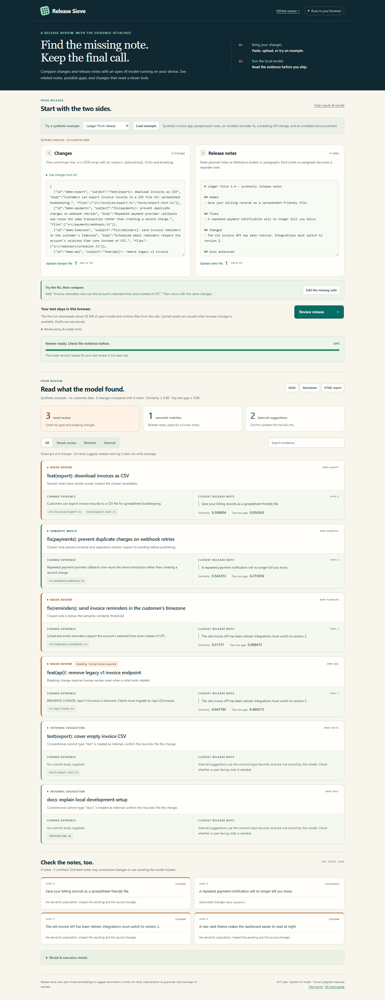

# Release Sieve

**Before you ship, check what your notes missed.** A local semantic release-note review tool for small software teams and freelance maintainers.

Release Sieve compares commit evidence with the notes for one release. Paste or upload evidence in the browser, run the open-weight model on your device, and inspect related notes, possible gaps, and breaking changes. Download an HTML report, a JSON record, or a Markdown review table. It does not write release notes or publish anything.

[Open the browser app](https://junaidahamed-7777.github.io/release-sieve/) · [Model provenance](docs/MODEL_CARD.md) · [Architecture](docs/ARCHITECTURE.md)



## Try it in the browser

Open the app, load a synthetic example, and choose **Review release**. The first run downloads approximately 38 MB of SHA-256-verified model and WebAssembly runtime assets from the same site. Your evidence is processed in a worker on your device; it is not included in network requests or saved in browser storage. Verified model assets may be cached. Later reviews reuse the loaded model. Cancellation terminates the worker.

Paste one commit subject per line or upload a JSON change array. Paste or upload Markdown notes for **one release**. The report has filters, search, source/candidate evidence, notes, and local downloads. You can add the example's missing note and review again to see how the result changes. Similarity is advisory; breaking changes and ambiguous candidates need human review.

The browser app needs HTTPS or localhost and a browser with WebAssembly, SIMD, BigInt, and Web Crypto support. It uses one WASM thread, so it does not need cross-origin isolation. Offline page reload is not promised; a loaded page with its model can perform later reviews without network access. No paid API, credential, or account is needed.

For a real Git range, export only the evidence you want to inspect, then load that file in the browser:

```sh
node scripts/export-changes.mjs --repo /path/to/repo --base v1.3.0 --head HEAD --out changes.json
```

The export is model-free and reads the source checkout without changing it. Files may contain private commit evidence; keep them local and choose deliberately which evidence to inspect.

## Use the command-line version

Requires **Node.js 22–26**, npm, and **Git 2.46+** for repository input. Actual execution was verified on Windows x64, Node 26.8.1. Other listed Node versions/platforms are supported targets, not verified claims. No GPU, API key, account, or paid service is required.

```sh
git clone https://github.com/JunaidAhamed-7777/release-sieve.git
cd release-sieve
npm ci --ignore-scripts
npm run bootstrap
npm run demo
npm run serve:demo
```

Open **http://127.0.0.1:4173**, or open `demo/output/audit.html` directly. The demo uses invented Ledger Finch changes, not a user's repository or customer data. The server binds only to loopback and serves only the sample report.

CLI installation requires internet access. Bootstrap explicitly downloads four public, ungated model artifacts from a pinned Hugging Face revision: **23,685,047 bytes** in total, excluding npm packages. Every file is SHA-256 checked. Later CLI audits run with remote model loading disabled, including when the local model is missing; there is no silent download or paid fallback.

To build and serve the browser version locally after bootstrap, run `npm run build:web` and `npm run serve:app`. The app is served at **http://127.0.0.1:4173**. The browser distribution contains the same pinned model plus a WASM runtime; it does not require a model API endpoint.

## Audit a local release

Supply **notes for one release**, not an entire historical changelog:

```sh
node src/cli.mjs --repo /path/to/repo --base v1.3.0 --head HEAD --notes release-notes.md --out review
```

On Windows, quote paths containing spaces. `base..head` means commits reachable from head and not base. Exact branch/tag names, HEAD, and commit hashes are supported; revision expressions such as `HEAD~3` are intentionally rejected. Merge commits are excluded, while ordinary commits on merged branches remain included. Merge-only conflict resolutions and uncommitted changes are not analyzed.

You can also provide a JSON array of `{id, subject, body?, files?, breaking?}` objects:

```sh
node src/cli.mjs --changes demo/changes.json --notes demo/notes.md --out review
```

The collector reads commit subjects, bodies, and changed filenames. **It does not inspect code diffs or prove code behavior.** It does not write to the input repository, execute repository code, follow commit instructions, contact Git remotes, or publish notes. Output files may contain the selected evidence: keep real reports local unless you intentionally share them.

Use `--force` to replace existing audit files. Use `--fail-on-review` for an opt-in CI gate: exit **0** means no review items, **2** means review items remain, and **1** means an input/runtime/output error. Exit 0 is not proof of correct or complete notes.

## How decisions work

1. Conventional `docs`, `test`, `build`, `chore`, `ci`, `style`, and `refactor` labels produce **internal suggestions**, unless the change is marked breaking. This heuristic may be wrong; inspect these rows too.
2. The pinned **all-MiniLM-L6-v2** model encodes the remaining subjects/bodies and note text as normalized 384-dimensional vectors, using q8 ONNX inference on CPU.
3. A change is a **semantic match** when its best cosine score is at least **0.48** and its gap to the next note is at least **0.06**. With only one note, the gap uses zero as its baseline. Defaults are review heuristics, not calibrated confidence scores. Override with `--threshold` and `--margin`.
4. Weak matches, ambiguous matches, and every breaking change remain **needs review**. Unlinked notes get their own panel. A reviewed candidate does not count as a passed note link.

Each input is truncated to 256 wordpieces including special tokens, in batches of eight. The report records truncation. Limits: 500 changes, 200 notes, and a 500,000-character combined evidence budget. English prose is the intended input. Negation, identifiers, version numbers, dense jargon, and broad notes can fool similarity models. Human release review is essential.

## The included result

The committed [synthetic report](demo/output/audit.json) records **3 review items, 1 semantic match, and 2 internal suggestions**:

- A customer-friendly payment note matches the webhook retry fix.
- The omitted timezone reminder change has a weak candidate and needs review.
- An API removal remains a high-priority review item despite a related migration note.
- The CSV export has a plausible note but a top-two gap of 0.058622, below 0.06: the tool declines to make a firm association.
- The dark-theme announcement has no passed change link. That is a question to investigate, not an accusation of fabrication.

No customers, payments, time savings, or production accuracy are claimed. The side-hustle hypothesis is that a freelance release maintainer or small product team might pay for a review workflow/integration that reduces overlooked customer-facing changes. This prototype needs user validation.

## Verification

```sh
npm test
npm run test:model
npm run test:e2e
npm run test:browser
npm run test:web
```

Unit tests exercise ranking, ambiguity, input boundaries, malformed vectors, breaking changes, Git safety, and report escaping. Model verification actively forbids `fetch`, checks vector dimensions/normalization and truncation, and compares a paraphrase with an unrelated phrase. End-to-end verification creates and removes its own synthetic Git fixture, runs real inference, checks outputs/exit codes, and verifies the source repository is unchanged. Browser verification uses an already-installed Edge/Chrome through Playwright, checks filters/search, desktop/mobile overflow, network isolation, and captures the synthetic screenshots. [Verification evidence](demo/).

Browser verification defaults to an installed Microsoft Edge. Set `RELEASE_SIEVE_BROWSER=chrome` to use an installed Google Chrome instead; the script does not download a browser. Tests use the OS temporary directory by default. Set `RELEASE_SIEVE_TEST_TMP` to a writable temporary directory when needed; it selects only newly created test fixture directories.

## Open innovation, licenses, and timing

Original code and synthetic fixtures: [MIT](LICENSE). Model export and Transformers.js: Apache-2.0. ONNX Runtime: MIT. Native CLI dependencies have their own notices, including LGPL libraries; see [third-party attribution](docs/THIRD_PARTY.md). The browser distribution contains the pinned model, WASM runtime, and their license/notice files. Native Node binaries and `node_modules` are not committed. No gated model terms or paid-service agreement is required.

This is a new project started **October 13, 2026** for [DEV Hacktoberfest Week 2: Side Hustle](https://dev.to/challenges/hacktoberfest-week2-2026-10-12). Both the browser app and CLI run real local inference. The committed sample reports are synthetic demonstration outputs. If commits are made after October 18, 2026 at 11:59 PM PDT, they must be identified here as post-deadline changes.

AI-assisted.
