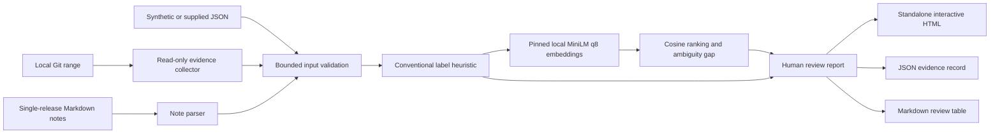

# Architecture and design choices

`src/git.mjs` uses argument-array subprocesses and resolves exact refs to commits before constructing a range. It disables inherited Git directory overrides, replacement objects, signature-display helpers, optional locks, and lazy fetching. It reads commit messages and filenames without code execution or remote services.

`src/audit.mjs` validates identifiers, text sizes, counts, and embeddings. It strips conventional prefixes from the model input while keeping the original subject visible. Internal labels are a separate, explainable heuristic; they are not AI impact classification. Remaining changes use semantic vectors and deterministic cosine ranking. A high score plus a sufficient best/runner-up gap creates a candidate association. Breaking markers override that association's status and require review.

The additive audit fields preserve a real `match.runnerUp` (ID, text, score) and `match.ambiguous`, decided from the unrounded top-two gap. A zero-similarity single-note baseline is never presented as a second note. `notes[].matches` contains accepted associations; `notes[].reviewMatches` separately retains strong breaking-change candidate IDs without relaxing the mandatory review gate. Both candidate types remain advisory evidence.

Markdown extraction bounds raw bullets/paragraphs before cleanup and uses linear scans for inline code and prose markup. Inline-code contents are preserved literally. Headings and fenced code blocks are excluded; closing fences must use the same character, at least the opening length, and a whitespace-only suffix. This deliberately limited parser does not promise full CommonMark interpretation.

`src/model.mjs` verifies the SHA-256 model manifest before loading an explicit local tokenizer and model. Direct tokenization enforces 256 tokens; mean pooling and L2 normalization produce sentence vectors. CPU inference uses bounded batches and two intra-op threads. It has no generation stage, no tools driven by model text, and no paid API fallback. The model does not receive code diffs or filenames; filenames stay in the evidence panel.

`src/report.mjs` builds one standalone HTML document. All evidence is escaped before insertion, filter metadata escapes HTML script delimiters, and browser interactions use `textContent`, attributes, and visibility rather than inserting untrusted HTML. A restrictive content policy blocks connections and remote assets. The HTML includes decisions, scores/gaps, all source evidence, notes, limitations, provenance, and truncation diagnostics.

`src/cli.mjs` validates before initializing inference and requires explicit overwrite of report files. JSON is the authoritative audit record; HTML and Markdown present the same canonical changes. Output is local. The demo HTTP server is optional and serves three fixed precomputed sample routes only on 127.0.0.1.

## Browser workbench

`web/app.mjs` owns the editable draft and review interface. It accepts one commit subject per line or canonical JSON rows, parses single-release Markdown notes, and validates before starting inference. Uploads are read locally. Results use text nodes, accessible filters, search, source/candidate evidence, and local Blob downloads. Input edits invalidate old results. Draft text is held in memory rather than browser storage.

`web/markdown.mjs` formats browser Markdown snapshots. Multiline metadata is collapsed and escaped; commit bodies remain quoted line by line so source text cannot forge report status or headings. JSON preserves original evidence, including original line breaks.

`web/worker.mjs` uses the same audit engine in a dedicated worker. A version-pinned BERT-only adapter imports the required upstream model/tokenizer implementation and registers only its encoder mapping, avoiding unrelated model registries. It fetches only fixed model/runtime assets from the app's origin, verifies byte sizes and SHA-256 hashes, and optionally caches those public assets. A custom memory cache exposes verified responses to Transformers.js while preventing inference code from initiating network requests. Tokenization, single-threaded WASM inference, vector pooling, ranking, and report assembly occur in the worker. Successful reviews keep the loaded model for another run. Cancel and Clear terminate the worker; run identifiers reject stale messages.

`scripts/build-web.mjs` copies revision-scoped model files, the required WASM runtime, license/notice materials, and bundled application source into `docs/`. It checks that native Node inference and image-processing dependencies are absent from the browser bundle. `docs/web-assets.json` records artifact sizes and hashes. The browser model/runtime payload is 37,974,266 bytes, excluding the small application bundles. `scripts/serve-web.mjs` serves the distribution on loopback for local use and testing. There is no inference server, user-data upload endpoint, or telemetry.

The model is reused offline in a loaded page. Offline page reload is not guaranteed. Browser numerical scores can differ slightly from Node CPU scores; decision thresholds remain human-review heuristics. The model-free `scripts/export-changes.mjs` exports a selected Git range for upload into the browser workbench.

## Why embeddings rather than a generative release writer?

The narrow problem is review: find a likely relationship between a developer's evidence and a customer's phrasing. Embeddings provide this comparison without creating claims about code behavior. Generation would add a second accuracy problem—verifying invented or broadened wording—and a larger runtime footprint. This project uses the open model as the part that relates paraphrases, with explicit policies around what the relationship is allowed to mean.

## What is deliberately outside scope?

No patch analysis, correctness proof, factual contradiction detection, semantic version recommendation, automated publishing, source secrets scanning, or customer-impact guarantee. Only one release's notes should be supplied. Large repos should select a smaller range rather than rely on silent sampling. The synthetic demonstration is evidence of working mechanics, not a labeled production evaluation or proof of business demand.
